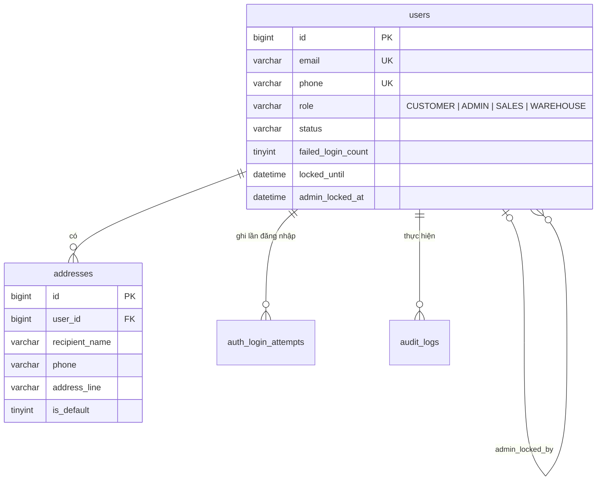
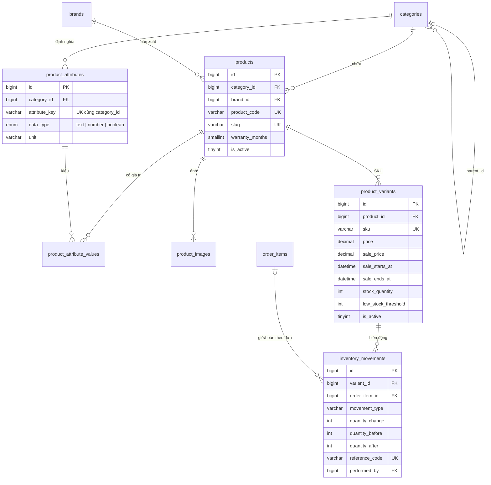
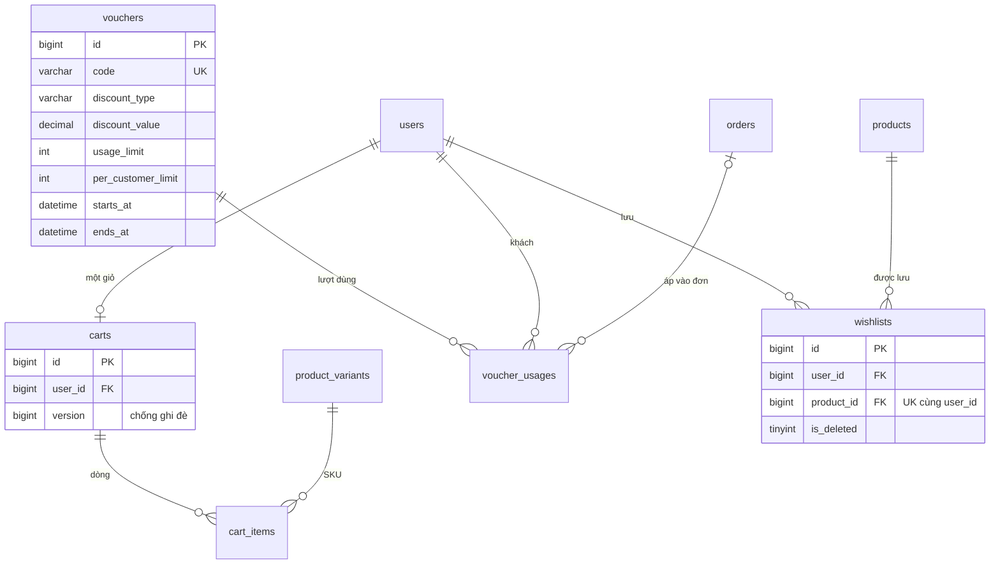
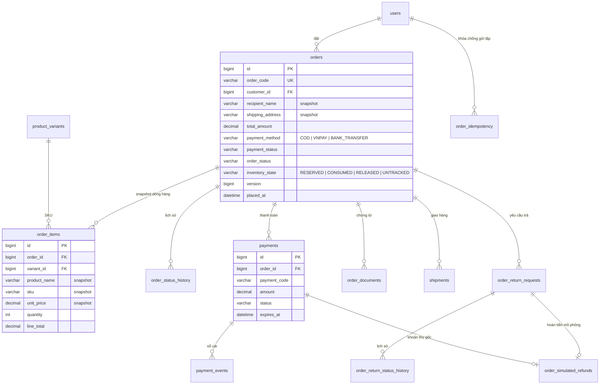
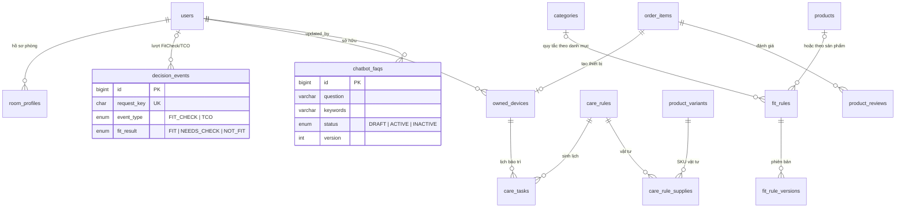

# ERD — HomeCare (MVP)

Cập nhật 12/11/2026 theo schema sau `server/db/setup.php migrate` (baseline + migration 008–020) trên MySQL 8.4. Sơ đồ chỉ vẽ khóa chính, khóa ngoại và cột nghiệp vụ chính; kiểu dữ liệu đầy đủ xem file migration. Tiền dùng `DECIMAL(14,2)` (VND nguyên), thời gian lưu UTC.

Quy ước chung: hầu hết bảng nghiệp vụ có `created_at`, `updated_at`, `is_deleted` (xóa mềm). Bảng `schema_migrations` do `setup.php` tạo để ghi các file đã áp.

## 1. Tài khoản và hồ sơ (CUS-01..05, USR-01)

## 2. Catalog và kho (PRD, WH-03/04)

`banners` đứng riêng (không khóa ngoại). Chi tiết quy tắc catalog/kho: [CATALOG-INVENTORY.md](CATALOG-INVENTORY.md).

## 3. Giỏ hàng, voucher, wishlist (CUS-10/11, PROMO)

## 4. Đơn hàng, thanh toán, trả hàng (ORD, CHK, PAY, RET)

Trạng thái đơn và trạng thái thanh toán tách riêng. Doanh thu ghi nhận ở lần đầu đơn chuyển `COMPLETED` (`order_status_history`), hoàn tiền ghi ở `order_simulated_refunds` — xem [DASHBOARD-METRICS.md](../api/DASHBOARD-METRICS.md).

## 5. Hỗ trợ chọn mua và sau mua (HOME, FIT, TCO, LIFE, CARE, BOT, REV)

## 6. Bảng phạm vi cũ (giữ, không dùng trong MVP)

`repair_requests`, `repair_appointments`, `repair_quotes`, `repair_quote_items`, `repair_media`, `repair_expenses`, `repair_status_history`, `repair_work_logs`, `repair_service_reviews`, `technician_unavailability`, `warranties`, `support_tickets`, `payment_reconciliations` và cột `payments.repair_request_id` đến từ baseline của phạm vi trước. Không triển khai, không xóa (theo AGENTS.md).

## 7. Index phục vụ truy vấn thường dùng

| Truy vấn | Index |
| --- | --- |
| Lọc sản phẩm theo danh mục/thương hiệu/trạng thái | `products.idx_product_filter (category_id, brand_id, is_active)` |
| Thông số cho FitCheck/so sánh | `products.idx_product_specs`, `product_attribute_values.uq_product_attribute` |
| Đơn của khách theo thời gian | `orders.idx_orders_customer_date (customer_id, placed_at)` |
| Dashboard/CSV theo kỳ | `orders.idx_orders_placed_at`, `orders.idx_orders_status_date`, `order_status_history.idx_status_history_status_order` (migration 020) |
| Hoàn tiền theo kỳ | `order_simulated_refunds.idx_simulated_refund_created` |
| Lượt FitCheck/TCO theo kỳ | `decision_events.idx_decision_type_date`, `idx_decision_created` (020) |
| Wishlist của khách | `wishlists.idx_wishlist_user_created` |

Đã kiểm bằng `EXPLAIN` trên dữ liệu seed: trước migration 020, lọc `orders.placed_at` quét toàn bảng và gom lịch sử `COMPLETED` quét toàn index; sau 020 lần lượt dùng `range` và `ref`. Bảng catalog (~60 sản phẩm, ~70 SKU) quét toàn bảng vẫn nhanh nên chưa thêm index cho cảnh báo tồn.
